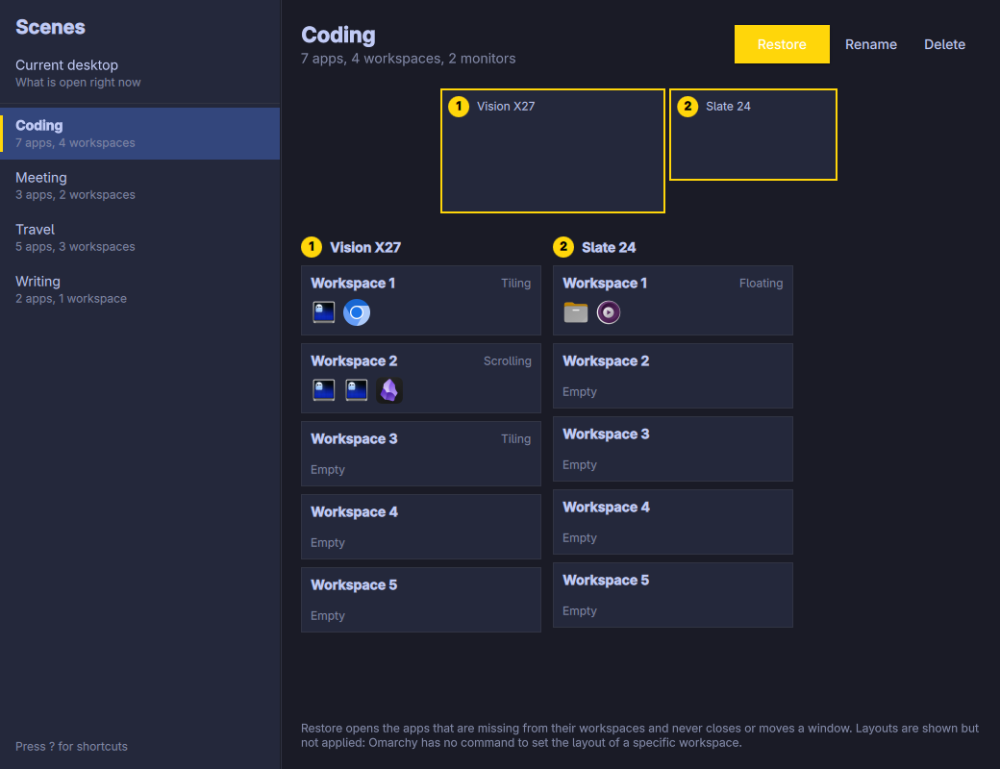

# Scenes

Save and restore named setups of your [Omarchy](https://omarchy.org) desktop.

A scene records, for each physical monitor and each workspace, the layout, the
apps open on it, and where each floating window sat. Restoring a scene opens the apps that are missing, on the
workspaces they belong to. Think "Coding", "Meeting", "Writing".

The window follows the Omarchy theme live (accent, light or dark, window
rounding) and the language picked under Setup > Language.

## Use

Arrange your desktop, open Scenes (`Super + Space`), and press `N`.

**A scene is the whole desktop, saved at once**: every monitor and every
workspace with its apps, not only the workspace you are looking at. You can't
save a single workspace or monitor on its own. Restoring works the same way: it
restores the whole scene, on every monitor, in one go.

| Key | Action |
|---|---|
| `Space` | Restore the selected scene |
| `N` | Save the current desktop as a new scene |
| `R` | Rename the selected scene |
| `Delete` | Delete the selected scene (asks first) |
| `Up` / `Down` | Select the previous or next scene; the first entry is the live **Current desktop** |
| `Ctrl+Z` / `Ctrl+Shift+Z` | Undo / redo a delete or rename |
| `F1` | Open the help (a short guide, and the About tab) |
| `?` | Show every shortcut |
| `Q` | Quit |

Single keys are off while a dialog is open, so typing a name never triggers them.
The **Help** and **About** buttons in the sidebar open the same dialog as `F1`.

The right pane draws the selected scene as its monitors, in their real
arrangement, and under them each monitor's workspaces with their layout and app
icons. Like Omarchy's bar it always shows workspaces 1-5 of every monitor (an
unused one reads "Empty" and claims no layout), and 6-10 only when a scene uses
them. A monitor that isn't plugged in right now is drawn dimmed.

## Command line

Every command takes `--json`, exits 0 or 1, writes errors to stderr, and needs
no display. The window is behind `scenes open`.

```sh
scenes list [--json]
scenes save <name> [--force] [--json]       # --force replaces an existing scene
scenes restore <name> [--dry-run] [--json]  # --dry-run prints exactly what would launch where
scenes check <name> [--json]                # are its monitors connected and its apps installed?
scenes skill install [--json]               # installs a short agent skill, bundled in the binary
```

Scenes are plain JSON in `~/.config/scenes/<slug>.json` (`"version": 1`), written
atomically. Set `SCENES_DIR` to use another directory.

## What restore does and doesn't do

- **It only adds.** It opens apps that are missing from a workspace and never
  closes or moves a window that is already open. Apps are launched the way
  Omarchy launches them.
- **Each new window is placed.** Apps that hand over to a running instance
  (Files, Chromium, Firefox) ignore a workspace rule and open on the active
  workspace. So after each launch Scenes waits for that app's new window on
  Hyprland's event socket, moves it to its workspace without following it, and
  gives focus back. Only a window that opened after the launch, and whose class
  belongs to the app, is ever moved. If no window appears within ten seconds,
  the app is reported as failed.
- **Monitors are bound by identity** (make, model, serial), not by connector
  name like `DP-1`, which a dock changes. If a scene's monitor isn't connected,
  its workspaces are reported as not placed. They are never moved onto another
  monitor.
- **Floating windows keep their place.** A window that was floating is saved
  with its position and size, measured from its monitor's corner. When restore
  opens it, it is made floating and put there, scaled if that monitor has a
  different resolution now. This only applies to windows restore opens itself;
  one that is already open is never moved or resized.
- **Workspaces are matched per monitor** through Omarchy's block of ten
  workspace ids per monitor, read from `~/.local/state/omarchy/monitor-workspaces`.
- **Named workspaces are skipped.** Hyprland reports a negative id for them, and
  it reads a leading `-` as a relative selector, so they can't be targeted
  safely. The window and `scenes save` say which were skipped.
- **Windows with no desktop entry are left out**, and counted.
- Restore runs off the GUI thread and reports which apps failed to start.

### Known gap: layouts are shown, not applied

A scene stores each workspace's layout (tiling, scrolling or floating), and the
window shows it. **Restore can't set it.** Omarchy has no command that sets the
layout of a specific workspace: `omarchy-hyprland-workspace-layout-toggle` only
cycles the active workspace, and `omarchy-hyprland-workspace-layout-default`
changes the default. Setting it any other way means writing Omarchy's own state
files, which Scenes never does. When a workspace's layout differs, restore says
so, in the window and in `--json` (`layouts_not_applied`).

If Omarchy gains a command for it, restore can apply layouts with no change to
the scene format.

## Later

Out of scope for v1:

- Saving or restoring part of the desktop. Today a scene is always the whole
  desktop, every monitor and every workspace, saved and restored at once. A
  later version could save only one workspace or only one monitor ("save just
  this monitor"), and restore a scene on selected monitors only.
- Terminal working directories
- Browser tabs
- Applying layouts (see the gap above)

## Build

Needs `qmake6`, `make`, a C++ compiler and Qt's base, declarative and wayland modules.

```sh
bin/build           # build/scenes
bin/test            # unit tests, the real window driven offscreen, catalog checks
bin/install         # makepkg -fsi: installs the package (needs sudo)
bin/install-local   # installs into ~/.local without root
```

`tests/screenshot.cpp` renders the real window offscreen against made-up
content, in any theme or language: `scenes_screenshot --state list --theme light --lang sv --out shot.png`.

## License

MIT. See `LICENSE`.
